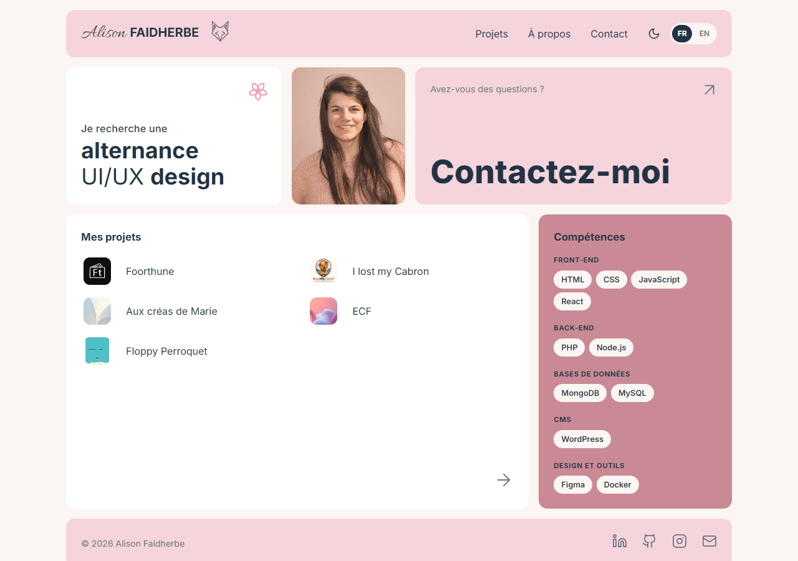
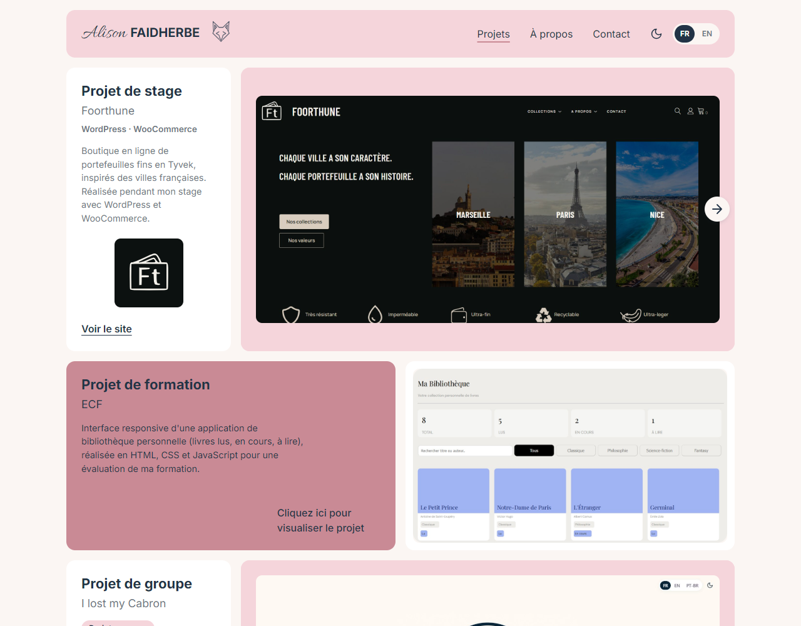
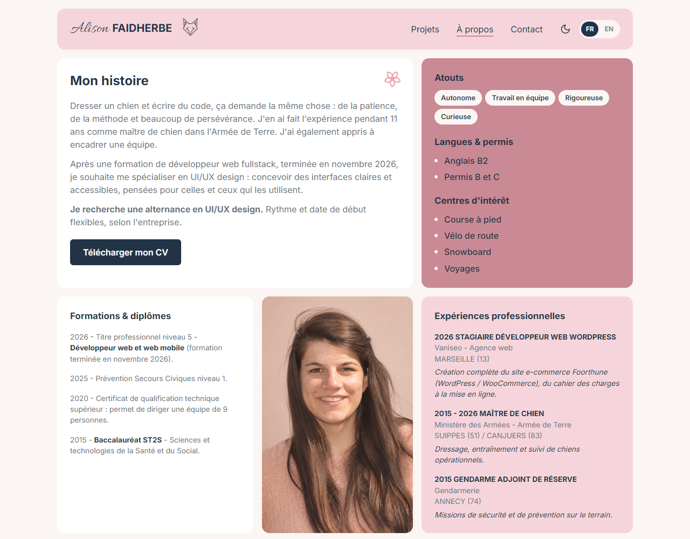
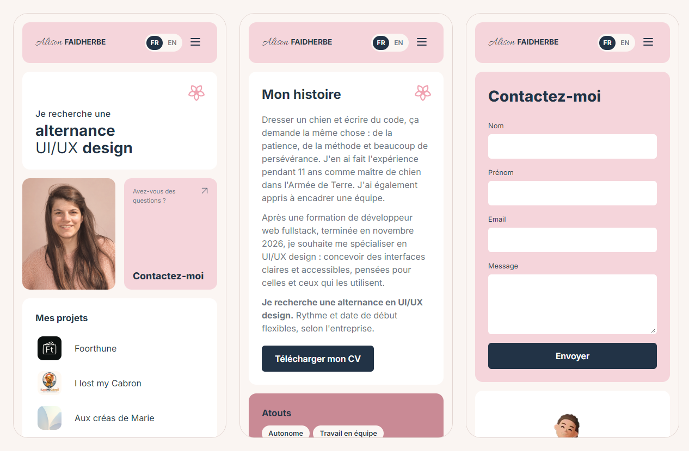

# Portfolio · Alison Faidherbe

**🔗 [alliiissonnee.github.io](https://alliiissonnee.github.io/)**

Formée au développement web fullstack (titre professionnel Développeur web et web mobile, formation terminée en novembre 2026), je recherche une **alternance en UI/UX design**. Rythme et date de début flexibles, selon l'entreprise.

Ce portfolio présente mon parcours, mes projets et un formulaire pour me contacter. Je l'ai maquetté sur Figma puis codé à la main, sans framework.

## Le site

- **Accueil** : ce que je recherche, un aperçu de mes projets et de mes compétences
- **Projets** : mes projets de stage, de formation et personnels, chacun avec une courte description, des captures et le lien vers le site en ligne ou le code
- **À propos** : mon parcours, de maître de chien dans l'Armée de Terre au développement web puis au UI/UX design, et mon CV à télécharger
- **Contact** : formulaire envoyé via [Formspree](https://formspree.io)

Le site est disponible en **français et en anglais**. La langue suit celle du navigateur, et le CV téléchargé est dans la langue choisie.

## Mes projets

| Projet | Type | Technologies | Lien |
| --- | --- | --- | --- |
| Foorthune | Projet de stage | WordPress, WooCommerce | [foorthune.com](https://foorthune.com/) |
| ECF – Ma Bibliothèque | Projet de formation | HTML, CSS, JavaScript | [Code](https://github.com/Alliiissonnee/ECF) |
| I lost my Cabron | Projet de groupe | React, Node.js, Express, MongoDB, Supabase | [Code](https://github.com/wall966/iLostMyCabron) |
| Floppy Perroquet | Projet de formation | JavaScript | [Jouer](https://alliiissonnee.github.io/Floppy-Perroquet-/) |
| Aux créas de Marie | Projet personnel | HTML, CSS, JavaScript | [auxcreasdemarie.fr](https://auxcreasdemarie.fr/) · [Code](https://github.com/Alliiissonnee/Aux-cr-as-de-Marie) |

## Aperçu

| Accueil | Projets | À propos |
| --- | --- | --- |
|  |  |  |

<details>
<summary>Voir le site sur mobile</summary>



</details>

## Technologies

- Maquette conçue sur Figma
- HTML5 et CSS3 (Grid, Flexbox, media queries), sans framework
- JavaScript natif : traduction FR / EN, mode sombre, menu burger, galeries avec flèches

## Points soignés

- **Responsive** : ordinateur, tablette et téléphone
- **Mode sombre** : automatique selon l'appareil, avec un bouton pour choisir
- **Accessibilité** : textes alternatifs, navigation au clavier, libellés pour les lecteurs d'écran, respect du réglage « réduire les animations »
- **Sécurité** : Content Security Policy, liens externes protégés, champ anti-spam sur le formulaire

## Structure

```
├── index.html          Accueil
├── projets.html        Projets
├── a-propos.html       À propos
├── contact.html        Contact
├── css/style.css
├── js/
│   ├── theme.js        Applique le mode sombre avant l'affichage de la page
│   ├── main.js         Traduction, mode sombre, menu, galeries
│   └── traductions.js  Textes en anglais
├── cv/                 CV en FR et EN : generer-cv.js crée les 2 pages HTML, imprimées en PDF
├── assets/             Images et CV en PDF
└── captures/           Captures d'écran de ce README
```

## Lancer le site en local

Aucune installation n'est nécessaire : ouvrez `index.html` dans un navigateur.

Pour modifier le CV : changez les textes dans `cv/generer-cv.js`, lancez `node cv/generer-cv.js`, puis imprimez `cv/cv.html` et `cv/cv-en.html` en PDF dans `assets/`.

## Contact

- [LinkedIn](https://www.linkedin.com/in/alliiissonnee)
- [GitHub](https://github.com/Alliiissonnee)
